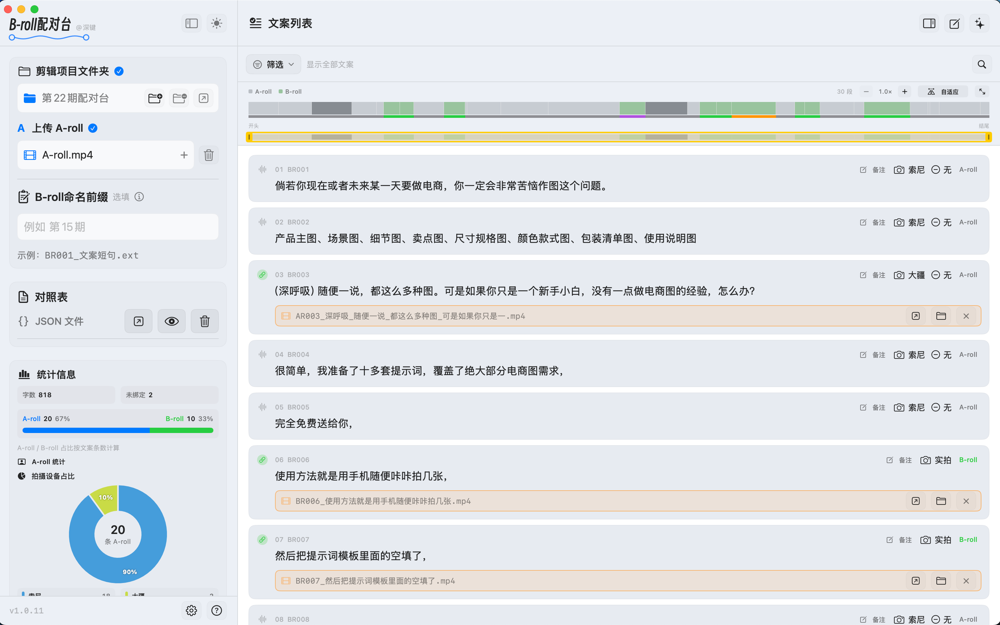
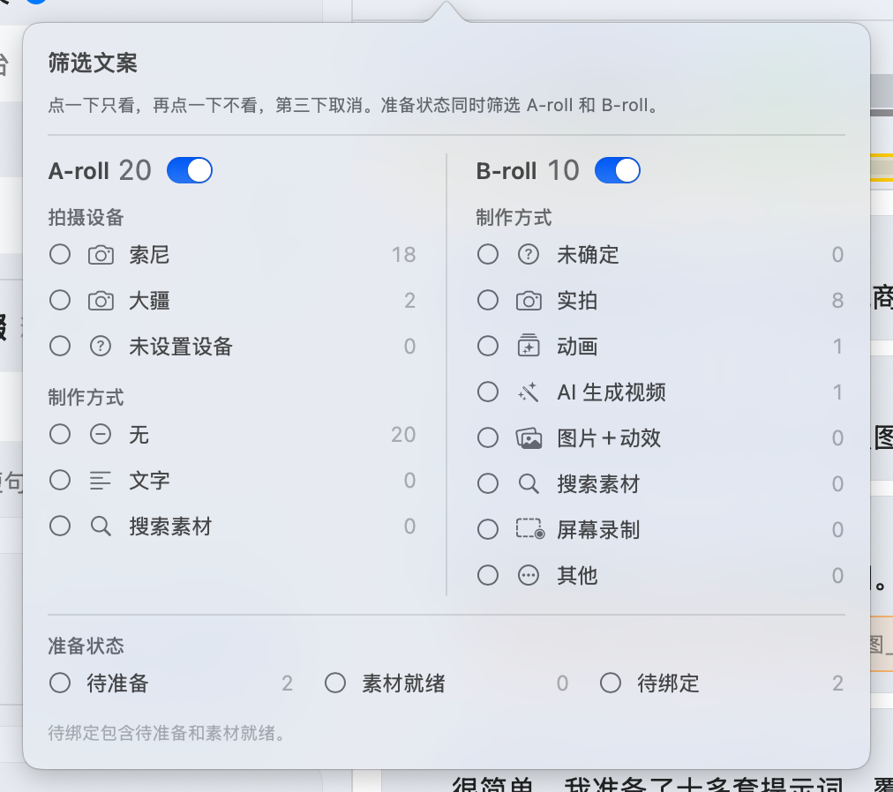
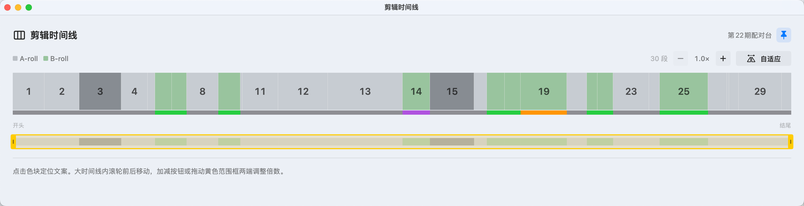
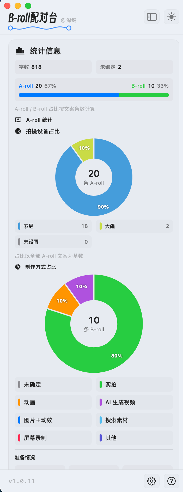
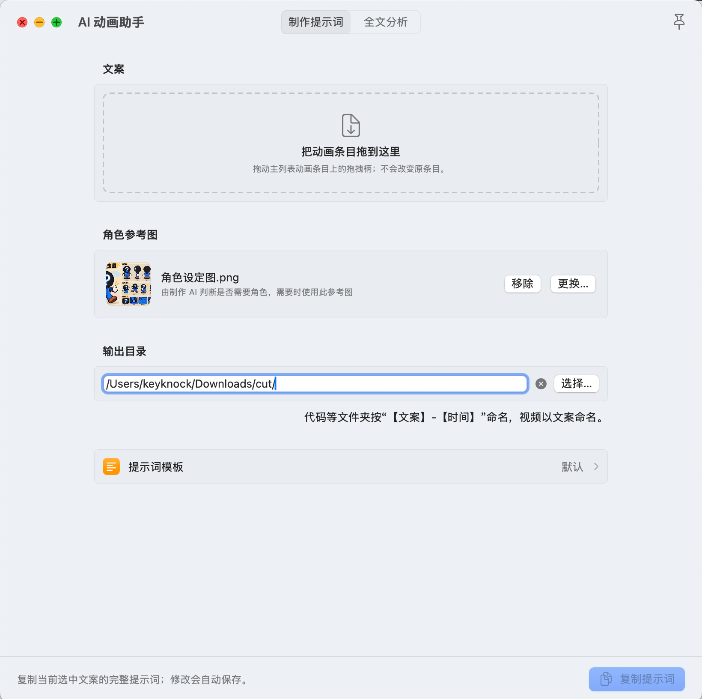
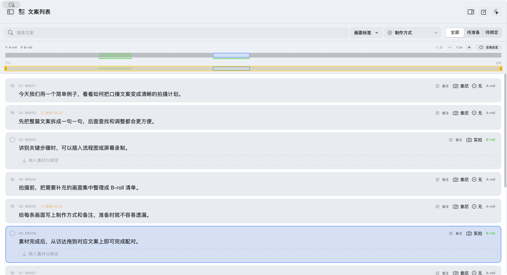

# B-roll 配对台

**把每句口播需要的画面列清楚，把素材拖到对应文案上，再交给 AI 做粗剪。**

B-roll 配对台是一款免费、开源的 macOS 工具，适合做口播、教程、知识分享类视频。你可以先用它规划要拍什么、要做什么，准备好后再给每句文案配上素材，减少剪辑时来回找文件、对台词的时间。

> **A-roll**：你对着镜头讲述的主画面。<br>
> **B-roll**：讲述时穿插的辅助画面，比如产品实拍、录屏、动画、AI 视频或图片。



## 下载与安装

需要 **macOS 14 或更新版本**。目前提供 Apple Silicon（M 系列芯片）安装包。

**[下载 v1.0.12 安装包（DMG）](https://github.com/knockkeykey/B-roll-Desk/releases/download/v1.0.12/B-roll-Desk-1.0.12-arm64.dmg)** · [查看最新版本](https://github.com/knockkeykey/B-roll-Desk/releases/latest)

打开 DMG，将 App 拖入“Applications（应用程序）”即可。

### 首次打开被 macOS 拦截怎么办？

当前 v1.0.12 已有 Developer ID 签名，但尚未完成 Apple 公证。如果首次打开时提示“Apple 无法检查此 App 是否包含恶意软件”或“无法验证开发者”，确认安装包来自上方的本项目 GitHub 发布页后，可以按以下步骤临时放行：

1. 在“应用程序”中尝试打开“B-roll 配对台”，出现提示后关闭提示窗口。
2. 打开 **系统设置 → 隐私与安全性**，向下滚动到“安全性”区域。
3. 找到“B-roll 配对台”被阻止的提示，点击 **“仍要打开”**。
4. 按系统提示验证身份，再点击 **“打开”**。

完成后，系统会记住对此 App 的允许，下次可正常双击打开。此操作只为当前 App 添加例外，无需关闭整个系统的安全检查。具体说明见 [Apple 官方操作指南](https://support.apple.com/zh-cn/102445)。

## 四步上手

### 1. 选好项目文件夹，导入口播和文案

在左侧选择一个空文件夹作为“剪辑项目文件夹”，App 会自动建立 `A-roll/` 和 `B-roll/` 两个子文件夹。

- 将录好的口播视频拖到“上传 A-roll”区域，也可以点击按钮选择视频。
- 点击“编辑 / 导入文案”，粘贴文案或导入 `.txt`、`.md` 文件。空白工作区也支持直接拖入文案文件。
- 选择“按换行拆分”或“按句号自动拆分”，整理成逐条文案。

口播视频会复制到 `A-roll/`，原文件保留。文案保存在 `A-roll/正确文案.txt`，之后在 App 里修改也会同步更新。

### 2. 标出哪些句子需要补画面

逐条看文案，需要保持口播画面的就用 **A-roll**；需要插入辅助画面的就切换为 **B-roll**，再选制作方式、写备注。

| 画面类型 | 可以设置什么 | 例子 |
| --- | --- | --- |
| A-roll | 拍摄设备；无、文字、搜索素材 | 这句用索尼主机位，那句用大疆补拍 |
| B-roll | 实拍、动画、AI 生成视频、图片＋动效、搜索素材、屏幕录制等 | 讲操作步骤时配录屏，讲流程时配动画 |

准备素材时，可把条目从“待准备”改成“素材就绪”；拖入并绑定素材后，会自动显示“已绑定”。准备状态适用于 B-roll 和辅设备 A-roll。

例如，文案写着“打开手机拍几张产品图”，就把这一句标成 **B-roll → 实拍**，备注“手机拍产品的近景”。先列好清单，再集中拍摄或制作。

### 3. 把素材拖到对应文案上

从访达把图片或视频拖到对应条目上，就完成配对。也可以打开右侧素材面板，添加素材来源目录，再从面板里拖入。**一条文案可以绑定多个素材。**

App 会把素材副本放进项目文件夹，按文案编号和内容命名，并自动更新对照表。来源文件不会被移动或重命名。左侧的“B-roll 命名前缀”可以填写期数或主题，方便以后查找。

### 4. 把项目和提示词交给 AI 粗剪

点击主窗口里的“复制提示词”，将提示词和**整个剪辑项目文件夹**一起提供给具备 ChatCut 剪辑能力的 AI。

AI 会根据真实口播和正确文案整理主口播，再按对照表放入辅机口播和 B-roll，保存可继续编辑的 ChatCut 时间线。配对台负责准备资料，实际剪辑需要通过 ChatCut 完成；完成后可以继续检查和调整口播、画面位置与节奏。

## 文案多了，怎么快速找到要做的内容？

### 用筛选器安排下一步

点击文案列表上方的“筛选”，可以按拍摄设备、制作方式和准备状态筛选。**同一个选项点一下“只看”，再点一下“不看”，第三下取消。** A-roll 和 B-roll 可以分别设置条件，也能关闭其中一类。

- 想知道还要准备什么：只看“待准备”。
- 想集中做动画：只看 B-roll 的“动画”，再叠加“待准备”。
- 想检查有没有漏配素材：只看“待绑定”，它包含“待准备”和“素材就绪”。
- 想找某句台词：按 `⌘F` 打开搜索。



### 用时间线查看画面分布

文案上方的色块会展示 A-roll / B-roll 分布，色条标出制作方式和 A-roll 拍摄设备。点击色块可以跳到对应文案，选中的文案和色块会同步高亮。

- “自适应”会跟随文案列表移动；“全局总览”方便查看全文。
- 点击 `−` / `+` 或拖动黄色范围框两端，可以调整缩放；拖动范围框可以前后移动。
- 在大时间线内滚动鼠标滚轮，可以查看前后的文案，缩放倍数保持不变。
- 点击右上角的放大图标，可以打开独立的“剪辑时间线”窗口，适合放到第二块屏幕，还能置顶。

**这里按文案长度展示分布，不是按真实视频时长生成的剪辑时间码。**



### 用统计检查整体准备情况

左侧统计区可以查看字数、未绑定数量、A-roll / B-roll 占比、拍摄设备分布和 B-roll 制作方式分布。占比按文案条数计算，方便判断哪些画面还需要准备。

<details>
<summary>展开查看统计面板</summary>



</details>

## AI 动画助手怎么用？

点击文案列表上方的“AI 动画助手”，可以让 AI 帮你挑适合做动画的段落，也可以为已经选好的段落整理制作提示词。

### 让 AI 推荐动画段落

1. 进入“全文分析”，配置自己的 DeepSeek API Key，并测试连接。
2. 按需修改判断规则，再发起分析。
3. 查看推荐结果，勾选想采用的段落，确认应用。

分析会将整篇文案发送给 DeepSeek。**只有确认应用后，App 才会拆分文案并标记为“B-roll / 动画”**，已有素材绑定会保留，整次操作可以用 `⌘Z` 撤销。API Key 只保存在本机 macOS 钥匙串，不写入项目或导出的 JSON。

### 为选好的动画文案复制提示词

1. 将条目的制作方式设为“动画”，用条目上的拖拽柄，把它拖到助手的文案区域。
2. 按需添加角色参考图、选择输出目录，并编辑提示词模板。
3. 点击底部“复制提示词”，交给能制作动画的 AI。需要引用角色图或输出目录时，确保制作 AI 能访问这些路径。

可以保留多条文案并切换选择，**每次复制的是当前选中条目的完整提示词**。主列表中的文案和备注修改也会同步到助手，备注会作为“表达重点”。助手负责整理提示词，动画制作由你使用的 AI 工具完成。

提示词模板、角色图和输出目录会保存到本机；拖入助手的文案列表仅在本次运行中保留，重启后需要重新拖入。



## 还有几个实用操作

| 想做什么 | 怎么操作 |
| --- | --- |
| 修改一句文案 | 双击条目编辑 |
| 拆成两条 | 编辑时在句末按 Enter |
| 与上一条合并 | 在条目开头按 Backspace |
| 撤销 / 重做 | `⌘Z` / `⇧⌘Z` |
| 编辑或导入整篇文案 | `⇧⌘E` |
| 刷新素材目录 | `⇧⌘R` |
| 换成自己的拍摄设备 | 左下角设置 → 拍摄设备，修改后点击“保存设备选项” |
| 下次继续整理 | 重新选择原来的整个剪辑项目文件夹 |

### 有主机位和辅机位怎么办？

在拍摄设备设置里指定一个主设备和一个辅设备，设备设置在本机所有项目中共用。未单独选择设备的 A-roll 默认跟随主设备。

需要补拍的句子选择辅设备，再把补拍口播视频拖到这条文案上。它仍然是 A-roll，副本会保存到 `A-roll/`，并写入辅机对照表。AI 粗剪时会按对应台词插入这段补拍口播。

已绑定辅机素材的条目切回主设备时，会先确认是否取消绑定并删除项目副本，来源原件保留，也可以撤销恢复。

## 项目文件夹里有什么？

通常只需要把整个文件夹交给 AI，无需手动编辑 JSON。

```text
剪辑项目文件夹/
├── A-roll/
│   ├── A-roll.mov                 # 主口播副本，扩展名随原文件
│   ├── 正确文案.txt                # 在 App 中确认和修改的文案
│   ├── 第22期_AR003_文案短句.mp4   # 辅机口播副本
│   └── aroll-for-ai.json           # 主辅设备与辅机素材对照表
└── B-roll/
    ├── 第22期_BR006_文案短句.mp4   # 配对好的辅助素材副本
    ├── broll-for-ai.json           # 交给 AI 的文案与素材对照表
    ├── broll-manifest.json         # App 恢复素材绑定时使用
    └── project-settings.json       # 文案分类、准备状态等项目设置
```

**备份或迁移项目时，请保留整个文件夹。** 重新打开项目需要正确文案、完整绑定记录和项目设置，只保留给 AI 的对照表无法恢复完整项目。

<details>
<summary>旧项目兼容说明</summary>

如果旧项目中有 `B-roll/broll-for-codex.json`，请将它改名为 `broll-for-ai.json`，内容无需修改。App 不再生成或识别旧文件名。

用于恢复项目的 `B-roll/broll-manifest.json`、`B-roll/project-settings.json` 和 `A-roll/正确文案.txt` 保持原名。

</details>

<details>
<summary>早期界面示例（保留原有截图）</summary>



这张截图展示了时间线与文案的联动，当前界面请参考上方的新截图。

</details>

## 从源码运行与开发验证

源码位于 `BRollDeskApp/`。使用 Xcode 16.4 或更新版本打开 `B-roll Desk.xcodeproj`，选择 `B-roll Desk` scheme 后运行。

<details>
<summary>展开查看现有测试脚本</summary>

在仓库根目录使用 `bash Tests/脚本名.sh` 运行对应检查。

| 脚本 | 检查内容 |
| --- | --- |
| `run-script-import-tests.sh` | TXT / MD 导入、空白工作区拖入、保存和恢复 |
| `run-inline-auxiliary-tests.sh` | 文案拆分合并、撤销、主辅设备及素材归档 |
| `run-inline-optimization-tests.sh` | 文案迁移、缓存和后台保存兼容性 |
| `run-inline-performance-tests.sh` | 300 条文案的模型性能 |
| `run-animation-tests.sh` | 动画分析、结果应用、提示词和撤销；使用离线模拟响应 |
| `run-filter-tests.sh` | 筛选的只看、不看和取消，以及 A-roll / B-roll 分别筛选 |
| `run-timeline-tests.sh` | 时间线缩放、平移、范围跟随及状态保存 |
| `run-production-method-tests.sh` | A-roll / B-roll 制作方式 |
| `run-shooting-device-tests.sh` | 拍摄设备设置 |
| `run-distribution-tests.sh` | 文案分布计算 |

窗口交互和真实鼠标拖拽还需在 App 中验证。文案编辑性能的测量方式和待验收项见 [性能记录](docs/inline-edit-performance.md)。

</details>

## 许可证

项目代码、文档和图标以 **GNU GPLv3（GPL-3.0-only）** 授权，完整条款见 [LICENSE](LICENSE)。分发修改版时需遵守 GPLv3，并向接收者提供相应源码；仅供自己使用的修改无需公开。用这个 App 制作的视频和文案不会因此自动受 GPLv3 约束。

`BRollDeskApp/Fonts/` 中的第三方字体另有许可：内置得意黑 `SmileySans-Oblique.ttf` 按 **SIL Open Font License 1.1** 授权，版权声明与条款见 [OFL.txt](BRollDeskApp/Fonts/OFL.txt)。
